<h3><code>muzaki@github ~ $ ./contributions.sh</code></h3>

  

<h3><code>muzaki@github ~ $ whoami</code></h3>

<table>
  <tr>
    <td valign="top"></td>
    <td valign="top"></td>
  </tr>
</table>

  

<h3><code>muzaki@github ~ $ cat profile.yml</code></h3>

<b>Informatics Engineering Graduate · Full-Stack Developer · QA &amp; IT Infrastructure Enthusiast</b>

  Building reliable web applications, improving software quality, and supporting secure IT operations. 
  Bachelor of Informatics Engineering — STT Terpadu Nurul Fikri · GPA 3.86/4.00

  

  

“Stay curious, keep building, and grow consistently.”

